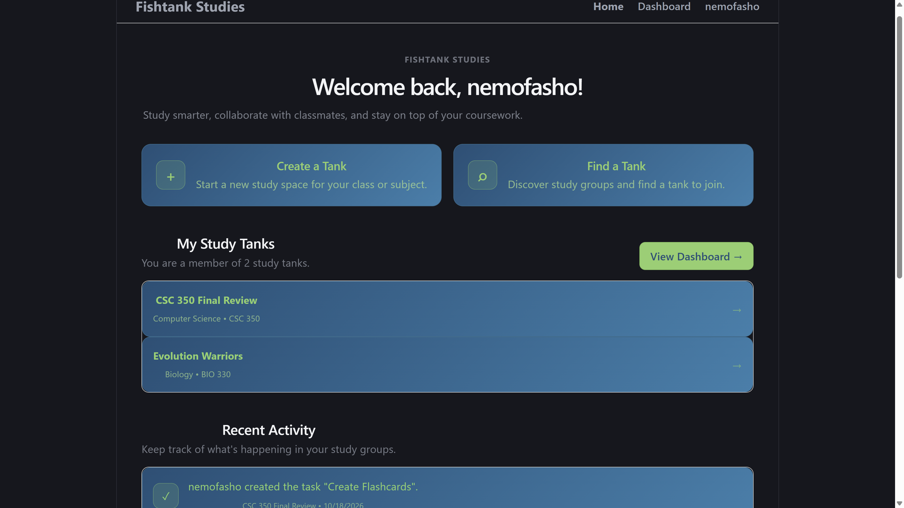
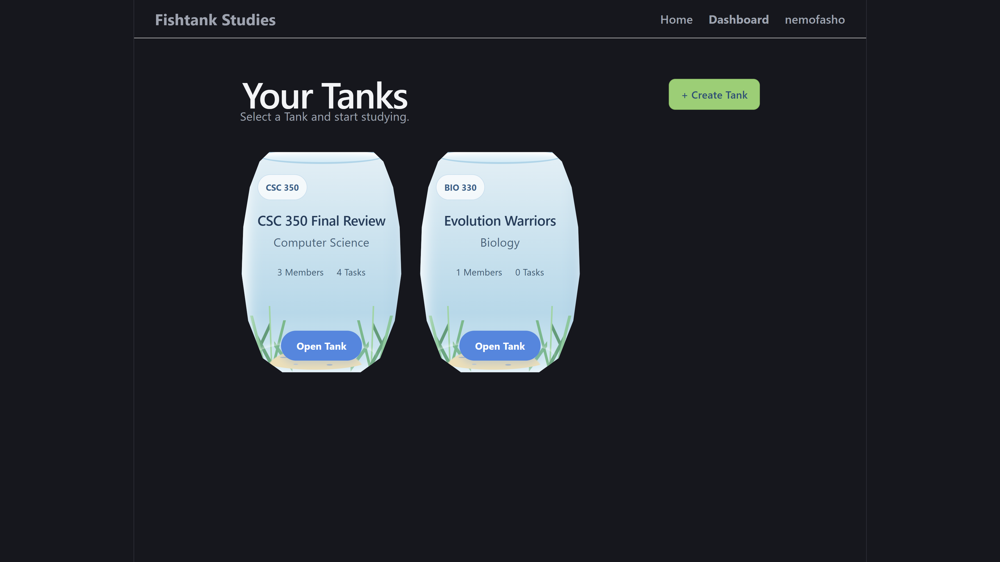
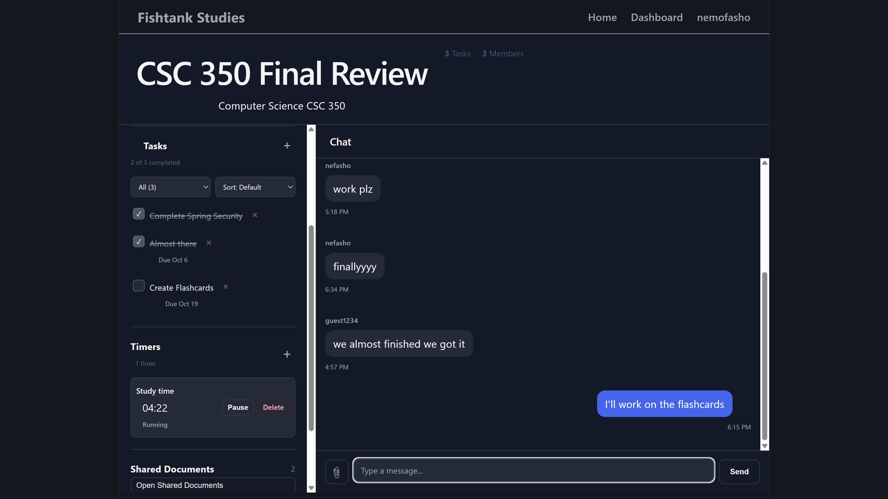
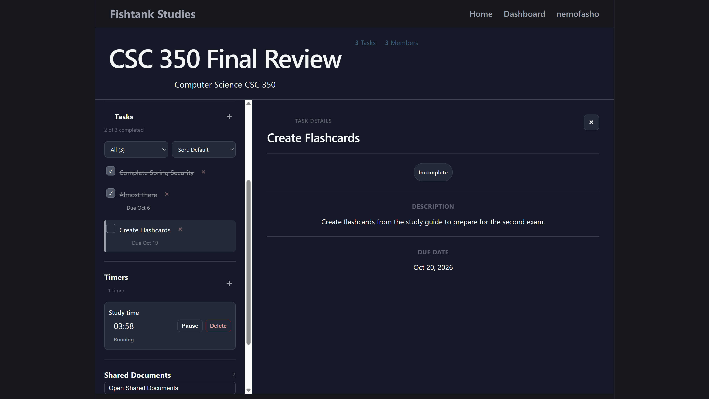
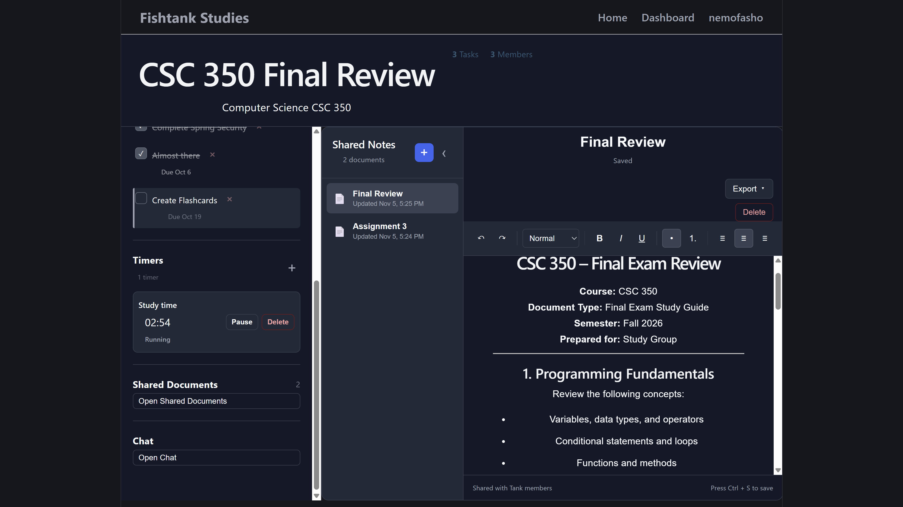

# 🐠 Fishtank Studies

**A collaborative study platform built to help students organize their coursework, study together, and manage their academic work in one place.**

**Project Status: Complete** ✅

Fishtank Studies is a full-stack web application where students can create or join study groups called *Tanks*. Each Tank provides a shared workspace for communicating, organizing tasks, tracking study sessions, and sharing study materials.

---

## Screenshots

### Home


### Dashboard


### Collaborative Tank Chat


### Tank Task


### Shared Documents


## ✨ Features

### 🔐 Authentication and User Profiles
- User registration and login.
- Secure password hashing with BCrypt.
- JWT-based authentication.
- Protected pages and authenticated API requests.
- User profiles with editable profile information.
- View your study Tanks and manage your account.

### 🐠 Study Tanks
- Create and manage study Tanks.
- Discover available Tanks through the Find a Tank page.
- Search for Tanks and filter by subject.
- Join study groups and access shared workspaces.
- View Tank information, membership, and task counts.
- Aquarium-inspired interface with custom CSS styling.

### 💬 Collaborative Chat
- Send messages within a Tank.
- Edit and delete messages.
- Share file attachments with other Tank members.

### ✅ Task Management
- Create, view, update, and delete study tasks.
- Organize academic work within each Tank.
- Access task details from the shared workspace.

### ⏱️ Study Timers
- Create and manage study timer sessions.
- View timers associated with a Tank.
- Update and delete timer sessions.

### 📄 Shared Documents
- Create and manage shared documents.
- Edit document information and remove documents.
- Organize study materials within a Tank.

### 📊 Dashboard and Recent Activity
- View your Tanks from the dashboard.
- Access Tank workspaces quickly.
- Review recent activity across the application.
- Monitor study group participation and task counts.

### 🎨 User Interface
- Custom fishbowl-themed Tank cards.
- Responsive layouts for different screen sizes.
- Dedicated pages for authentication, profiles, Tank discovery, and study workspaces.
- Consistent styling across the application.

---

## 🛠️ Technology Stack

### Frontend

| Technology | Purpose |
|---|---|
| React | Component-based user interface |
| JavaScript (ES6+) | Frontend application logic |
| Vite | Frontend development server and build tooling |
| React Router | Client-side navigation and protected routes |
| CSS3 | Styling, responsive layouts, and aquarium-themed visuals |
| Fetch / API service functions | Communication with the backend REST API |

### Backend

| Technology | Purpose |
|---|---|
| Java 21 | Backend programming language |
| Spring Boot 3.5.3 | Backend application framework |
| Spring Web | REST API development |
| Spring Data JPA | Database access and persistence |
| Hibernate | Object-relational mapping |
| Spring Security | Authentication and endpoint protection |
| JSON Web Tokens (JWT) | Stateless authentication |
| BCrypt | Secure password hashing |
| Maven | Dependency management and build automation |

### Database and Development Tools

| Technology | Purpose |
|---|---|
| PostgreSQL | Relational database |
| Neon | Hosted PostgreSQL database |
| Git | Version control |
| GitHub | Source code hosting and collaboration |
| Visual Studio Code | Development environment |

---

## 🏗️ Application Architecture

Fishtank Studies uses a full-stack architecture with a React frontend communicating with a Spring Boot REST API, which persists application data in PostgreSQL.

```text
┌────────────────────────────────┐
│        React Frontend          │
│                                │
│  Pages • Components • Services │
│  Authentication • UI • Routing │
└───────────────┬────────────────┘
                │
                │ HTTP / REST API
                │ JWT Authentication
                ▼
┌────────────────────────────────┐
│      Spring Boot Backend       │
│                                │
│ Controllers • Services         │
│ Spring Security • JPA          │
│ Business Logic                 │
└───────────────┬────────────────┘
                │
                │ SQL / JPA
                ▼
┌────────────────────────────────┐
│      PostgreSQL on Neon        │
│                                │
│ Users • Tanks • Tasks          │
│ Messages • Timers • Documents  │
│ Other Application Data         │
└────────────────────────────────┘
```

### Backend Responsibilities
- Expose REST endpoints for application functionality.
- Authenticate users and protect secured endpoints.
- Validate incoming requests.
- Apply application business logic.
- Persist and retrieve application data through JPA.

### Frontend Responsibilities
- Render the user interface and application pages.
- Manage authentication state.
- Handle navigation and protected routes.
- Call backend endpoints through service modules.
- Display Tank data and provide interactive workspace functionality.

---

## 📁 Project Structure

The project is organized into separate frontend and backend applications.

```text
fishtank-studies/
├── frontend/
│   ├── src/
│   │   ├── components/
│   │   │   └── Tank/
│   │   │       ├── chat/
│   │   │       ├── documents/
│   │   │       ├── tasks/
│   │   │       └── whiteboards/
│   │   ├── context/
│   │   │   └── AuthContext.jsx
│   │   ├── pages/
│   │   ├── services/
│   │   ├── styles/
│   │   ├── App.jsx
│   │   └── main.jsx
│   └── package.json
│
├── backend/
│   ├── src/
│   │   └── main/
│   │       ├── java/
│   │       └── resources/
│   │           └── application.properties
│   └── pom.xml
│
└── README.md
```

*Note: This is a representative structure. Some filenames and folders may differ from the current repository.*

---

## 🚀 Getting Started

### Prerequisites

- Java Development Kit (JDK) 21
- Node.js and npm
- Maven, or use the project's Maven Wrapper if available
- A PostgreSQL database, such as Neon
- Git

### 1. Clone the Repository

```bash
git clone YOUR_GITHUB_REPOSITORY_URL
cd fishtank-studies
```

Replace `YOUR_GITHUB_REPOSITORY_URL` with the repository's actual clone URL.

### 2. Configure the Backend

Navigate to the backend directory:

```bash
cd backend
```

Configure `src/main/resources/application.properties` with your database connection and JWT settings.

Example configuration:

```properties
spring.datasource.url=${DATABASE_URL}
spring.datasource.username=${DATABASE_USERNAME}
spring.datasource.password=${DATABASE_PASSWORD}

spring.jpa.hibernate.ddl-auto=update
spring.jpa.show-sql=false

jwt.secret=${JWT_SECRET}
jwt.expiration=86400000
```

Set the environment variables to your actual database credentials and a sufficiently long, securely generated JWT secret. Use a JDBC-compatible PostgreSQL connection URL for the datasource.

**Security:** Never commit database credentials, JWT secrets, or other private configuration values to GitHub.

### 3. Start the Backend

From the `backend` directory, run:

```bash
.\mvnw.cmd spring-boot:run
```

If the project includes the Maven Wrapper, use the appropriate wrapper command for your operating system.

The backend will start on the configured Spring Boot port, typically `8080`.

### 4. Configure the Frontend

Open a second terminal and navigate to the frontend directory:

```bash
cd frontend
npm install
```

Configure the frontend API URL using the environment variable expected by the application. For example, if the code uses `VITE_API_URL`, configure it in a local `.env` file:

```env
VITE_API_URL=http://localhost:8080
```

Use the variable name expected by your actual frontend code; Vite only exposes frontend environment variables prefixed with `VITE_` by default.

### 5. Start the Frontend

From the `frontend` directory:

```bash
npm run dev
```

Open the local URL printed by Vite in your browser, typically `http://localhost:5173`.

---

## 🔒 Security

The application incorporates several security mechanisms:

- BCrypt password hashing.
- JWT-based authentication.
- Spring Security for access control.
- Protected frontend routes.
- Authenticated API requests.
- Externalized database credentials and JWT secrets.

Production deployment should also use HTTPS, secure secret management, appropriate CORS settings, and authorization checks for Tank membership and individual resources.

---

## 🔮 Future Improvements

Potential enhancements for future versions include:

- Real-time chat and collaborative updates using WebSockets.
- Improved inline previews for images and videos shared in chat.
- More advanced document collaboration.
- Deployment and production monitoring.
- Accessibility and performance improvements.

---

## 🎯 Project Goals

Fishtank Studies was designed to bring common student collaboration tools into a single application. Instead of managing study groups, tasks, messages, timers, and study materials across multiple platforms, students can use a shared Tank workspace to coordinate their work.

The project demonstrates full-stack development, REST API integration, database persistence, authentication, application architecture, and interactive frontend design.

---

## 👨‍💻 Developer

**Nehemiah McClain**

Computer Science student at the University of North Carolina at Greensboro.

- GitHub: [@nemofasho](https://github.com/nemofasho)


